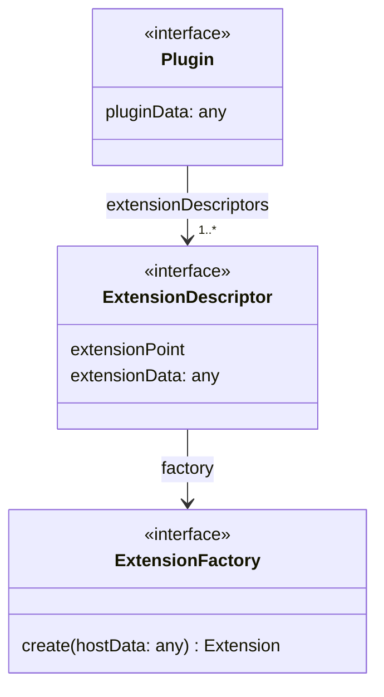
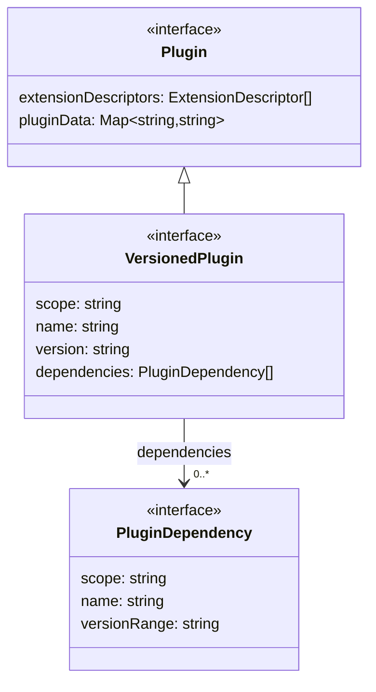
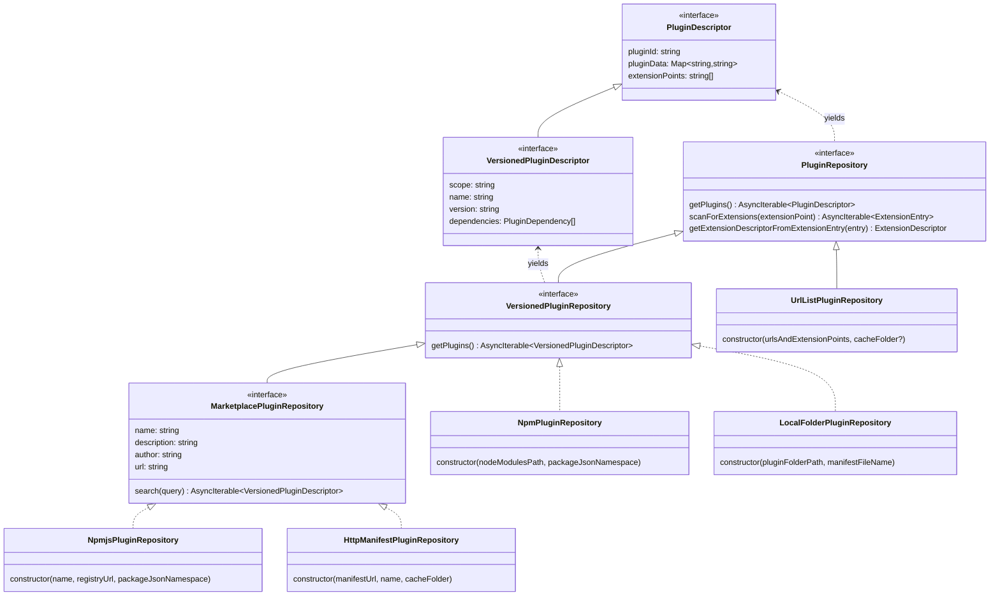
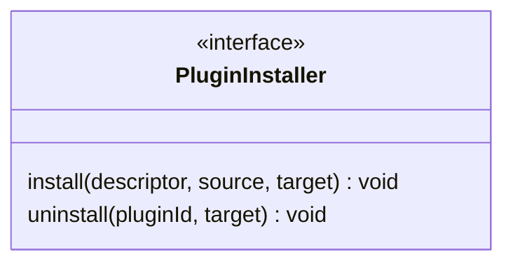
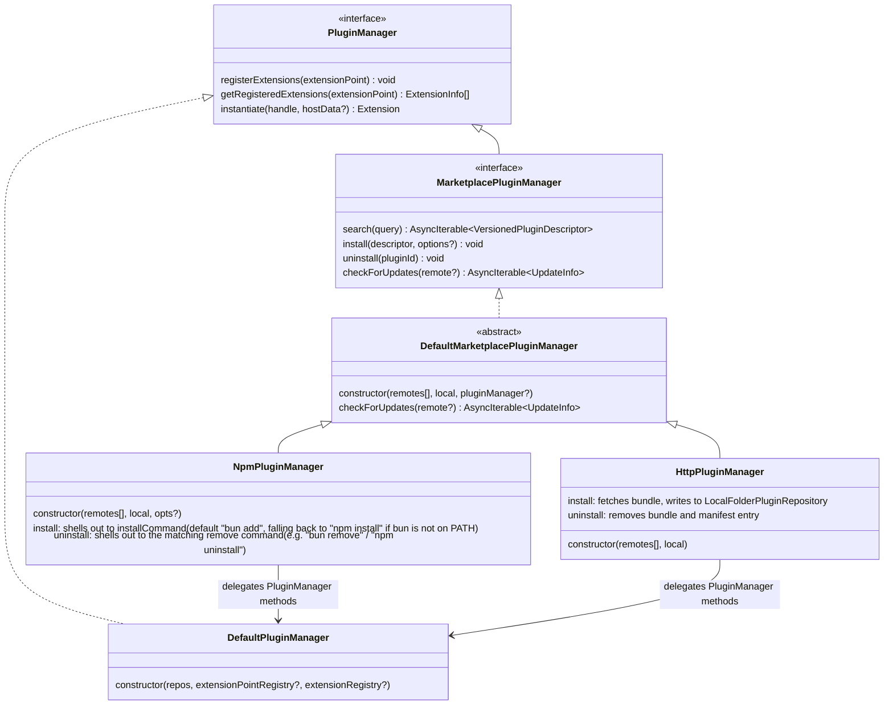
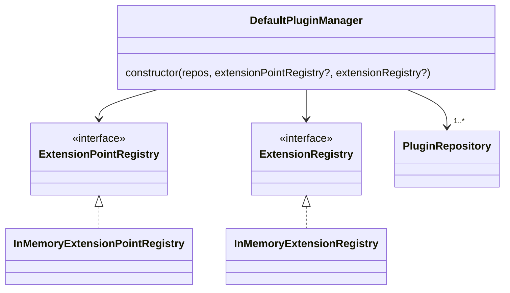
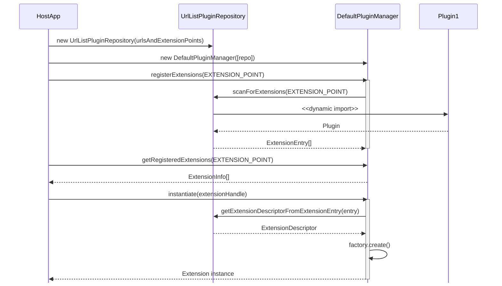
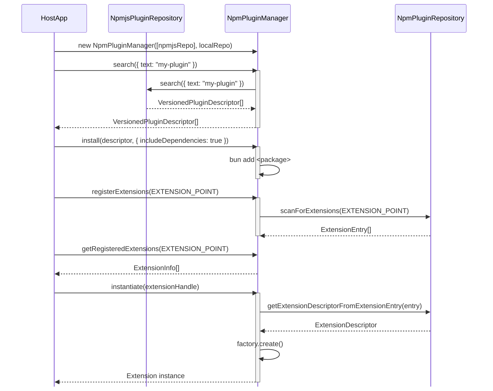

# Implementation Details

The package provides two entry points depending on use case.

**Plugin Authors**

Only the plugin-side interfaces are required. Import from the
`/plugin` subpath to keep the host implementation out of your module graph.
For example:

```typescript
import type {
  Plugin,
  ExtensionDescriptor,
  ExtensionFactory,
  PluginDependency,
  VersionedPlugin,
} from "@flowscripter/dynamic-plugin-framework/plugin";
```

_NPM Based Plugin Loading_

When building a plugin that will be consumed via `node_modules` (i.e.
using an `NpmPluginRepository` in the host application) transpile with `tsc`:

```json
{
  "compilerOptions": {
    "outDir": "dist",
    "rootDir": ".",
    "declaration": true,
    "rewriteRelativeImportExtensions": true
  },
  "include": ["index.ts", "src/**/*.ts"]
}
```

This mirrors the source tree into `dist/`, rewrites relative `.ts` imports
to `.js`, and leaves bare specifiers (e.g.
`@flowscripter/dynamic-plugin-framework`) completely untouched
so they resolve via `node_modules` at runtime. Mark host-supplied packages as
`peerDependencies` in the plugin `package.json` and let
regular `dependencies` resolve from `node_modules` the same way.

_URL Based Plugin Loading_

If the plugin is meant to be fully self-contained and loaded via URL/CDN rather
than `node_modules` (i.e. using a `UrlListPluginRepository` in the host
application) then bundle (e.g. `bun build`). A host-supplied package which
is only referenced via `import type` is fully erased at compile time, so it
can be marked `--external` and `peerDependency` as a guardrail. A host-supplied
package with a real value import (for example a class used with `instanceof`
across the plugin boundary) can also be marked `--external` and
`peerDependency`, provided the host supplies it with `registerSharedModules`
(see [Shared Modules](#shared-modules)). Any other package with a value import
must stay bundled.

A bundled plugin only needs `.d.ts` files when the bundle itself is imported
directly by other code (for example tests) rather than loaded by URL.

A bundle is loaded at runtime and is not imported as a package dependency, so
it does not need type declarations. If the same package is also imported
directly by tests or other code (for example, to use the exported types or
classes of a plugin), also emit `.d.ts` files (for example `tsc` with
`declaration: true` into `dist/`) and point the `types` field and the `types`
condition of `exports` at them. A bundle-only package without declarations is
imported as an untyped module in that case.

**Host Application Authors**

Import from the main entry point, which exposes
the full API including concrete implementations. For example:

```typescript
import {
  DefaultPluginManager,
  NpmjsPluginRepository,
  NpmPluginRepository,
  NpmPluginManager,
} from "@flowscripter/dynamic-plugin-framework";
import type { ExtensionInfo, PluginManager } from "@flowscripter/dynamic-plugin-framework";
```

## Shared Modules

A plugin loaded from a fetched file (`UrlListPluginRepository`,
`HttpManifestPluginRepository`, `HttpPluginManager`) lives in a cache folder with
no `node_modules`, so a bare import which the bundler left external (for
example `@flowscripter/pluggable-io-framework-api`) cannot be resolved. A plugin
installed under a separate prefix has the same problem in a different form: it
resolves its own second copy of the package, so `instanceof` fails across the
plugin boundary. The host solves both by supplying the module itself.

### Bun Hosts

The host registers the module namespaces once at startup, before any plugin
which imports them is loaded:

```typescript
import { registerSharedModules } from "@flowscripter/dynamic-plugin-framework";
import * as ioApi from "@flowscripter/pluggable-io-framework-api";
import pkg from "@flowscripter/pluggable-io-framework-api/package.json" with { type: "json" };

registerSharedModules({
  "@flowscripter/pluggable-io-framework-api": { version: pkg.version, exports: ioApi },
});
```

Any plugin (fetched or from `node_modules`) which imports that specifier then
receives the host's namespace. This is implemented with Bun virtual modules
(`Bun.plugin` and `build.module`), which work in plain `bun`, `bun test` and
`bun build --compile` executables, from any working directory.

Rules and limits:

- Registration is process-global.
- Register before the first plugin which imports the specifier is loaded. Bun
  cannot replace a virtual module once it has been imported, so registering the
  same specifier again with a different `exports` object throws. Registering the
  same object again is a no-op.
- Matching is exact. `pkg/sub` must be registered separately from `pkg`.
- The registered value is a snapshot of the namespace object. Later
  reassignment of a `let` export is not reflected.
- `registerSharedModules` throws when not running under Bun.
- The `version` is supplied by the host. The framework does not read it.

### Fetched Bundle Preflight

Before a fetched bundle is imported, its imports are scanned with
`Bun.Transpiler.scanImports`. A bare import which is not a Node or Bun builtin
and is not registered is rejected: `loadPlugin` returns `isValidPlugin: false`
with an error naming the specifier. This stops Bun resolving (or auto-installing)
an unrelated npm package of the same name, and replaces a confusing resolution
failure with a message pointing at `registerSharedModules`.

- The check runs on every load, so registering a module after a failed load
  makes the same cached file load.
- Plugins imported from a local path or `node_modules` are not preflighted. Their
  bare imports resolve from their own tree, or from the registry if registered.
- `import(variable)` cannot be scanned and is not checked. The preflight is a
  guard against unresolved externals, not a security boundary.
- A bundle which relied on Bun auto-installing a package at import time is
  rejected.

### Declaring Required Versions

A plugin may declare the host modules it needs and the supported semver range:

```typescript
import type { Plugin } from "@flowscripter/dynamic-plugin-framework/plugin";

const plugin: Plugin = {
  extensionDescriptors: [/* ... */],
  sharedModules: { "@flowscripter/pluggable-io-framework-api": "^3.0.0" },
};
```

After the module is imported each entry is checked against the host. The plugin
is invalid (`loadPlugin` returns `isValidPlugin: false`) if the host has not
declared the module, the range is not a valid semver range, or the host version
does not satisfy the range (prereleases are included). If the host registered
the module without a `version` the plugin is accepted and a warning is logged. A
plugin which declares nothing is not checked, and version skew then surfaces as
a link error on a missing export. The declaration is read after the module is
evaluated, so it is the preflight which blocks an unregistered import.

### Browser Hosts

`registerSharedModules` is not available in a browser. Use a native import map
declared before any module script which depends on it:

```html
<script type="importmap">
  {
    "imports": {
      "@flowscripter/pluggable-io-framework-api": "/shared/pluggable-io-framework-api.js"
    }
  }
</script>
```

A plugin built with `--external @flowscripter/pluggable-io-framework-api` then
resolves the bare specifier through the map in a plain `import(url)`. In a
runtime without `Bun`, `loadPlugin` imports the URL directly (the browser
caches over HTTP) and does not scan the source. An unresolved specifier fails
with the browser's `TypeError`, which `loadPlugin` returns as the error with a
hint to add the module to the import map.

The host declares the versions of the modules supplied by the import map so
that `sharedModules` ranges can be checked:

```typescript
import { describeSharedModules } from "@flowscripter/dynamic-plugin-framework";

describeSharedModules({ "@flowscripter/pluggable-io-framework-api": "3.1.0" });
```

Rules and limits:

- One class identity: the module URL in the import map must be the module the
  host itself imports. The host's own bundle must treat the package as external
  and import it through the same specifier. A host which bundles its own copy
  has two copies and `instanceof` fails again.
- An import map must be defined before the first module script which depends on
  it. A map added later only affects specifiers not already resolved and cannot
  override an existing mapping.
- Check `HTMLScriptElement.supports("importmap")`. A fallback for browsers without
  import map support is the responsibility of the host.
- Blob and data URL modules also resolve through the document's import map.
- The unit tests cover the Bun-less loader branch and the range check. The
  import map behaviour itself is not exercised in real browsers by the test suite.

## Plugin API

The following diagram provides an overview of the `Plugin` API:



A `VersionedPlugin` extends `Plugin` with metadata that can be used by versioned repositories and installers without loading the plugin module:



## PluginRepository API

The framework provides a hierarchy of `PluginRepository` interfaces. The base interface is extended by `VersionedPluginRepository` (for repos with version metadata in a backing store) and further by `MarketplacePluginRepository` (for remote marketplaces):



## PluginInstaller API

`PluginInstaller` provides the base install/uninstall contract for transferring plugins between repositories:



## PluginManager API

`DefaultPluginManager` handles standard plugin discovery and instantiation. `MarketplacePluginManager` extends the `PluginManager` API with search, install, uninstall, and update checking, delegating standard manager methods to an internal `DefaultPluginManager` backed by the local repository:



## Registry API

`DefaultPluginManager` tracks extension points and registered extensions via the `ExtensionPointRegistry` and `ExtensionRegistry` interfaces. In-memory implementations are used by default and alternatives can be supplied via the `DefaultPluginManager` constructor:



## Plugin Discovery and Instantiation Flow

The following sequence diagram shows the flow for using `DefaultPluginManager` directly with a `UrlListPluginRepository`:



## Marketplace Plugin Discovery, Installation and Instantiation Flow

The following sequence diagram shows the flow for using `NpmPluginManager` to search, install, and instantiate plugins from the npm marketplace:


